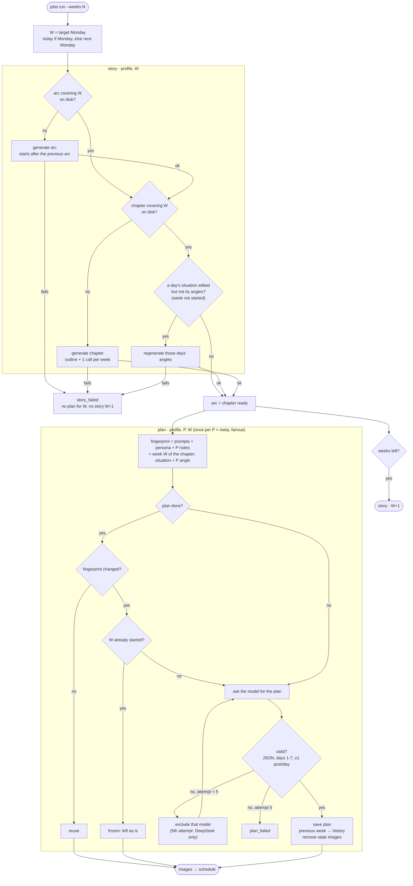

# Story → plan flow

What `jobs run` does for one profile and one target week `W`, from the season
arc down to each platform's weekly plan. Diamonds are the conditions that
decide what is reused, generated, regenerated or blocked. The code is the
source of truth (`jobs/tasks.py:run_story`/`run_plan`,
`planning/story_manager.py`, `planning/planning_manager.py`); keep this
diagram in sync when those conditions change.

## Rules the diagram does not show

- **What is on disk wins.** An existing arc or chapter is never regenerated
  because the persona or notes changed: both are meant to be edited by hand.
  Only `arc plan --force` / `chapter plan --force` rebuild them.
- **Angles follow the situation.** Each chapter day stores a fingerprint of
  its situation and angles. Editing only a situation regenerates that day's
  angles; editing the angles too keeps yours. Days in a week that already
  started are never touched.
- **Retries.** The arc, the chapter outline, each chapter week, each angle
  refresh and each plan get 5 attempts. After an invalid reply that model is
  excluded, and the last attempt goes to the paid fallback (DeepSeek). If any
  chapter call fails, nothing is saved.
- **Isolation.** Platform P's plan only sees the chapter's situation and P's
  own angle, never the arc or the other platform's angle or notes.
- **What triggers a re-plan.** Only a change in that plan's fingerprint:
  prompts, persona, P's notes, or week W of the chapter. Editing another week
  does not touch W.
- **Sizes.** `story/config.json` holds `arc_weeks` (default 12) and
  `chapter_weeks` (default 4). Chapters tile the arc from its start; the last
  one may be shorter.
- **Outside `jobs run`.** `meta plan`, `fanvue plan` and `all run_all` also
  make sure the arc and chapter exist (and reconcile hand edits) before
  planning, without fingerprints or frozen weeks.
